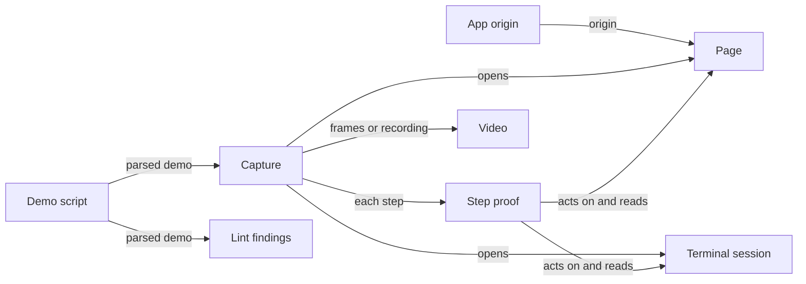

# sprintshow architecture

sprintshow is a demo-capture engine, packaged as `@zookanalytics/sprintshow` with a
command-line interface and a library. A markdown demo script drives an app in a browser
or a shell in a terminal, and the engine turns the run into a video or a screenshot, with
each step's claim checked against the screen.

## Scope

This document is the architecture of the whole repository: the engine in `src/`, with its
command-line interface and library, the samples and examples in `demos/` and
`examples/`, and how the engine meets the systems around it. It leaves these topics to
the living docs that hold them:

- Writing a demo script and running each command: [README.md](../README.md).
- The frames manifest that an agent's own capture hands to `assemble`:
  [examples/agent-mcp/README.md](../examples/agent-mcp/README.md).
- Preparing a page in a test and handing it to a capture:
  [examples/seed-test/README.md](../examples/seed-test/README.md).
- How each part works, and why: its module's header comment in [src/](../src/).
- What each test pins: its file's header comment in [test/](../test/).
- Work this document does not describe as architecture: the repository's beads.

## Purpose and quality goals

sprintshow gives an AI agent a way to show a person the work it just did, in a quick,
unpolished demo like a team's sprint demo. One script drives each kind of capture: a
walkthrough video, a proof video of one frame per step, or a screenshot.

The quality goals, in rank order:

1. **Truthful.** A capture shows what the app or the shell did. Each step's proof is
   checked against the live page or terminal, and a failed proof is reported, never
   hidden.
2. **Unattended.** An agent runs a capture with no person present, on a macOS or Linux
   host and beside other captures. The run asks nothing, leaves nothing running, and
   either saves its output or says what stopped it.
3. **Legible.** A person who has not read the script can follow the demo. Each step has
   a caption, the walkthrough moves at a human pace, and narration voices the captions
   when a speech key is set.

## Context

The boundary is the capture. sprintshow takes a demo script and an app or a shell, and
leaves an MP4 or a PNG at a path for the caller to publish.

| Who or what | Its role |
|---|---|
| An agent or a developer | Writes the script, runs a command or calls the library, and reads the log and the exit code. |
| A person watching, such as a pull request's reviewer | Watches the MP4 or looks at the PNG wherever the caller puts it. |
| The app under demo | Answers over HTTP at an origin: a server already running, a dev-server command sprintshow starts and stops, or a static directory sprintshow serves. |
| bash, and the programs a terminal script runs | Run on the host in a pseudo-terminal, in the directory the caller names. |
| Chromium, through Playwright | Shows every page, the engine's terminal page included, records the walkthrough and takes every screenshot. |
| ffmpeg | Encodes, mixes and muxes every video. |
| OpenAI's speech API | Voices each caption when `OPENAI_API_KEY` is set. |
| Vercel's Deployment Protection | Stands in front of a protected deployment, and lets the engine through with the key in `VERCEL_AUTOMATION_BYPASS_SECRET`. |
| git and git-LFS | Tell the linter whether a committed MP4 would be stored in LFS. |
| An agent that drives its own browser, such as through `@playwright/mcp` | Hands its frames and manifest to `sprintshow assemble`. sprintshow does not run it. |
| gc-toolkit's demo check | Runs the command-line interface from a checkout of this repository, or from the published package, and learns which commands and script kinds the engine has from `sprintshow help`. |

## Domains

| Domain | Responsibility | Data it owns | Must not |
|---|---|---|---|
| [Demo script](../src/demo-script.ts) | Read a markdown demo script into a parsed demo. | The grammar, and a script's parsed header, steps, actions, proofs and scrutiny items. | Run anything: other parts run what it parses. |
| [Lint findings](../src/lint.ts) | Report what a capture would ignore or get wrong in a script, before one runs. | The lint rules, and their findings on one script. | Start a browser, a server or a shell. |
| [App origin](../src/server.ts) | Give a page script an origin: a server already running, a dev server it starts and stops, or a static directory it serves. | The origin, and any server process a run started. | Start anything for a terminal script, which runs with no server. |
| Page ([browser.ts](../src/browser.ts), [vercel.ts](../src/vercel.ts)) | Open a page script's app in Chromium as the script's device, past Vercel's sign-in when the app is behind it. | The browser context: its device, its viewport, and the cookie that passes Vercel's sign-in. | Send the bypass key beyond the app's origin. |
| [Terminal session](../src/terminal.ts) | Run a terminal script's bash in a pseudo-terminal, shown by xterm.js in the capture's page. | The shell and its jobs, the screen and its scrollback, and the last command's exit status. | Interpret the shell's output itself: xterm.js reads every escape sequence. |
| Step proof ([browser.ts](../src/browser.ts), [keyboard.ts](../src/keyboard.ts)) | Run one step's actions on the page or the terminal, then check its proof. | Each step's result: its proof held, failed with a reason, or was manual. | End the capture: an action that does not settle is logged, and the proof decides the step. |
| Capture ([walkthrough.ts](../src/walkthrough.ts), [capture.ts](../src/capture.ts), [screenshot.ts](../src/screenshot.ts), [overlay.ts](../src/overlay.ts)) | Turn a script's steps into a recorded take, a frame per step, or one PNG, and draw a video's captions, cards and pointer. | A run's working directory: its frames or its recording, and when each step shows. | Judge a step: each step's result comes from Step proof. |
| Video ([assemble.ts](../src/assemble.ts), [ffmpeg.ts](../src/ffmpeg.ts)) | Encode frames or a recording into an MP4, and lay narration and a music bed under it. | The frames manifest, the narration track and the audio mix. | Need the app or a browser: it works from files on disk. |
| Samples ([demos/](../demos/), [sample-app](../examples/sample-app/), [sample-cli](../examples/sample-cli/)) | Give a capture something to drive with no app of one's own. | The sample scripts, and the sample app and terminal program they drive. | Need anything the package does not ship. |

How the domains meet in a capture:

### Product verticals

What a user runs, and the domains each draws on:

| Vertical | What it gives | Domains it draws on |
|---|---|---|
| `sprintshow run` | A walkthrough: one continuous take at a human pace, with live captions and a pointer. | Demo script, App origin and Page or Terminal session, Step proof, Capture, Video |
| `sprintshow run --mode proof` | A proof video: one captioned frame per step. | Demo script, App origin and Page or Terminal session, Step proof, Capture, Video |
| `sprintshow screenshot` | One PNG of the state the last step leaves, with nothing of the engine's drawn on it. | Demo script, App origin and Page or Terminal session, Step proof, Capture |
| `sprintshow assemble` | An MP4 from the frames and manifest of an agent's own capture. | Video |
| `sprintshow lint` | A script's findings, before a capture. | Demo script, Lint findings |
| The library | Each command's driver and the parts under it, for a caller that prepares its own page or drives its own steps. | Every domain but Samples |

## Cross-cutting rules

- **One reading of a script.** Every part that reads a demo script reads it through the
  parser in Demo script, so the linter, each capture and a library caller see the same
  steps.
- **One step runner.** Every capture, a library caller's own driver included, runs its
  steps through Step proof, so a proof means the same thing in a video and in a
  screenshot.
- **A failed proof shows and never stops a capture.** It is counted and logged, a video
  draws it on the step's caption, and the output is still saved. The exit code of `run`
  and `screenshot` says whether the output was saved and whether every proof held
  ([exit codes](../README.md#exit-codes)).
- **The silent video is the contract.** Narration and the music bed are laid over a
  finished silent video, and a failure in either keeps the silent video.
- **A key is written nowhere.** The engine reads a key from the environment, never from a
  flag, sends it only to the service it is for, and writes it to no log, caption,
  narration, URL, file or error. A key only the engine uses, such as the Vercel bypass
  key, stays out of a terminal script's shell.
- **A capture ends what it started.** It stops the dev server it spawned, closes the
  browser it launched, and ends the shell with every job the shell runs.
- **Captures share a host.** A run's static-server port, its working directory under
  `.captures/` and its temporary files are its own, so captures run side by side.
- **Binaries are provisioned.** A binary the engine needs, such as Chromium or ffmpeg,
  comes from a named npm script (`provision:browser`, `provision:ffmpeg`) or from the
  host, never from a dependency's install script. A part that finds one missing fails
  with the command that fetches it.
- **Behavior lives in the library.** The command-line interface parses flags and calls
  the library's exports, so a library caller can do whatever a command does.
- **The source runs as written.** Every source file is TypeScript that Node 22.18 or
  later runs by stripping its types: a relative import names the `.ts` file, and no
  syntax needs a transform. The tests and a checkout's command-line interface run the
  source, and only the published package runs the build.

## Decisions

- A demo script is markdown that reads as a walkthrough and carries its directives in
  backticks, so one file documents a demo and drives it.
- The parser keeps what it does not recognize as prose, and the linter reports it. A
  draft in the generic `demo:capture` dialect runs unedited, and adapting one only adds
  lines.
- A script drives one surface, set by its header: an app's page (`**Start:**`) or a
  terminal (`**Terminal:**`). It reads only that surface's actions and assertions.
- Playwright drives Chromium for every capture, and a device a script names is one from
  Playwright's registry.
- The engine draws its captions, cards, pointer and terminal as DOM in the page, and
  ffmpeg draws no text. Text drawn in the page stays sharp at any scale.
- The terminal is the engine's own: xterm.js in a page the engine writes, on bash in a
  pseudo-terminal from `@lydell/node-pty`, whose prompt marks (OSC 133) report each
  command's end and exit status. That pty package installs prebuilt on macOS and Linux,
  with nothing to compile.
- Signing in to an app and seeding its data are the caller's, who hands a capture a
  prepared page, and a script's `**Auth:**` line is read and ignored. Vercel's Deployment
  Protection is the exception: the engine passes it itself, with the bypass key from the
  environment.
- The proof video and an agent that drives its own browser share one hand-off: frames and
  a `manifest.json`, which `assemble` encodes.

## Debt

| Gap | Why a reader must know it | Retired by |
|---|---|---|
| The package is not on npm. | A consumer runs a checkout's `src/cli.ts`, and the README's `npx` and `npm install` lines fail. | Publishing the package, which needs the npm account owner's credentials (ss-rck). |
| A terminal script's shell inherits `VERCEL_AUTOMATION_BYPASS_SECRET`. | A step that prints the environment films the key, against *A key is written nowhere*. | Withholding the key from the shell (ss-fj0y). |
| The repository blocks no dependency's install script. | An npm that runs install scripts runs each dependency's at install, `ffmpeg-static`'s among them, against *Binaries are provisioned*. | Blocking install scripts, with ffmpeg fetched by its named script (ss-aq7h). |
| A walkthrough whose setup throws leaves its browser open. | The command never exits, against *A capture ends what it started*. | Closing what the walkthrough opened on any throw (ss-f8qx). |
| A narration clip that ffmpeg cannot decode fails the capture. | The run saves no video, against *The silent video is the contract*. | Treating a clip that does not decode as a failed synthesis (ss-vfg0). |
